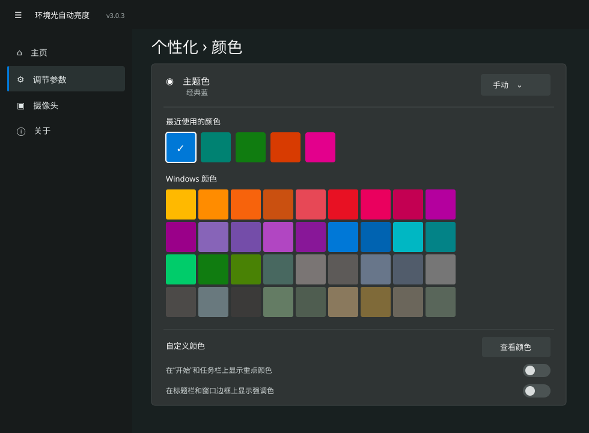

# 环境光自动亮度

> 用笔记本摄像头当「环境光传感器」，自动调节屏幕亮度 —— 亮了调亮，暗了调暗。

[](https://github.com/liuzishuo702-sys/BrightnessAuto)
[](https://dotnet.microsoft.com/download)
[](https://aka.ms/windowsappsdk)
[]()



---

## 为什么会有这个项目

很多笔记本没有环境光传感器（ALS），亮度只能手动调。这个项目把**摄像头当成眼睛**：
持续取帧算平均亮度，映射成屏幕亮度，用 WMI 落到底层硬件上。

使用场景：晚上关灯后屏幕刺眼、白天拉窗帘后又看不清 —— 与其每次手动拖亮度条，不如让它自己动。

---

## 功能

| 功能 | 说明 |
|---|---|
| 🎥 **摄像头测光** | `MediaCapture` + `MediaFrameReader` 取帧，计算全画面平均灰度（0–255） |
| 🎚️ **自动调亮度** | EMA 平滑 → 伽马曲线映射 → 死区判断 → WMI 设置，带硬件淡入过渡 |
| 📷 **测光摄像头可选** | 自动优先**内置摄像头**、避开手机投屏等虚拟设备；也可手动指定 |
| ⚙️ **7 项可调参数** | 检测间隔、亮度上下限、死区、过渡时间、平滑系数、强光跳满阈值 |
| 🌗 **插电 / 电池双策略** | 跟随电源自动切换，或固定用某一套；拔插电源无需重启 |
| 🎬 **场景预设** | 办公 / 观影 / 游戏 一键切换 |
| 👤 **无人自动锁屏** | 人脸检测 + 键鼠空闲判定，锁屏前弹 10 秒倒计时提醒 |
| 🪑 **久坐提醒** | 按真实时间累计（默认 45 分钟），人离开自动清零 |
| 🔋 **电量显示** | 主页显示充电状态与电量百分比 |
| 🎨 **WinUI 3 界面** | 卡片布局、Acrylic 磨砂、浅色/深色主题、悬停光影、系统托盘 |
| 🌡️ **联动色温** | 可选由 LightBulb 接管色温（需自行安装） |

---

## 系统要求

| 项目 | 要求 |
|---|---|
| 系统 | Windows 10 1809+ / Windows 11（64 位） |
| 硬件 | **带摄像头的笔记本**，且内置屏支持软件调亮度 |
| 运行时 | [.NET 9](https://dotnet.microsoft.com/download) + [Windows App Runtime 1.7](https://aka.ms/windowsappsdk) |

> ⚠️ 外接显示器 / 台式机多数不暴露 `WmiMonitorBrightness`，**无法用本软件调亮度**。
> 台式机若无内置屏，就算插了摄像头也只能测光、不能调节。

---

## 安装

### 从 Release 安装（推荐）

前往 **[Releases](https://github.com/liuzishuo702-sys/BrightnessAuto/releases/latest)** 下载：

| 文件 | 用途 |
|---|---|
| `BrightnessAuto_x.x.x_x64.msix` | 安装包本体 |
| `BrightnessAuto_x.x.x_x64.cer` | 配套公钥证书（安装前需信任） |
| `Install.ps1` | 一键脚本：信任证书 + 安装 + 启动 |

**方式一（一键脚本）**：把三个文件放同一目录，右键 `Install.ps1` → 使用 PowerShell 运行。

**方式二（手动）**：

1. 双击 `.cer` → 安装证书 → **本地计算机** → **受信任的根证书颁发机构**
2. 双击 `.msix` → 安装
3. 开始菜单搜索「**环境光自动亮度**」启动，主页点「**开始**」并允许摄像头权限

### 从源码构建

```powershell
# 需要 .NET 9 SDK + Windows 10/11 SDK
cd Project1/BrightnessAuto
dotnet build -c Release -p:Platform=x64
```

打包 MSIX（需先把签名证书导入当前用户证书存储）：

```powershell
cd Project1/BrightnessAuto
dotnet build -c Release -p:Platform=x64 `
  -p:GenerateAppxPackageOnBuild=true `
  -p:AppxBundle=Never `
  -p:AppxPackageSigningEnabled=true `
  -p:PackageCertificateThumbprint=<你的证书指纹>
```

> 💡 **三个容易踩的坑**：
> 1. 只加 `-p:AppxPackageSigningEnabled` 是**不会出包**的，必须显式加 `-p:GenerateAppxPackageOnBuild=true`；
> 2. 版本号由 `Package.appxmanifest` 里的 `<Identity Version="...">` 决定，
>    传 `-p:AppxPackageVersion` **不生效**；
> 3. 若构建报 `obj\...\input.json 访问被拒` 或 XAML 生成文件重复定义，**先删掉 `obj/` 和 `bin/`** 再构建。

也可用 Visual Studio 打开 `Project1/Project1.sln` 调试。

---

## 使用说明

启动后点「开始」，程序会：

```
打开摄像头 → 取帧算平均亮度 → EMA 平滑 → 映射目标亮度
    → 连续 3 次稳定才应用 → 限制单次跳变 → WMI 设置（带淡入）
```

### 参数怎么调

| 参数 | 作用 | 调大 | 调小 |
|---|---|---|---|
| 检测间隔 | 多久采样一次 | 更省电、反应慢 | 反应快、更耗电 |
| 亮度上下限 | 输出范围钳制 | — | — |
| 死区 | 目标与当前差小于此值不动 | 更稳、但可能不跟手 | 更跟手、易抖动 |
| 过渡时间 | 硬件淡入时长 | 变化更柔和 | 变化更干脆 |
| 平滑系数 | EMA 权重 α | 跟手快、易受噪声影响 | 平滑稳、滞后明显 |
| 强光跳满 | 环境光 ≥ 此值直接最高亮度 | 更少触发 | 更容易跳满 |

**默认值**：间隔 3s · 亮度 10%–100% · 死区 3% · 过渡 2s · 平滑 35% · 强光阈值 101

> 电池策略默认降为：最高 70% · 间隔 5s · 平滑 30%

### 测光摄像头选择

「摄像头」页可指定用哪个摄像头测光：

- **自动（推荐）** —— 按 `内置前摄 > 内置 > 普通/外接 > 名字含"虚拟"` 排序
- 手动指定 —— 例如想用手机当网络摄像头测光

> 为什么默认避开虚拟摄像头：手机投屏类虚拟摄像头测的是**手机朝向**而不是房间亮度，
> 还持续占用手机电量和网络。切换后需重新点「开始」生效。

---

## 调节算法

```
luma          = 全画面平均灰度 (0–255)
smooth        = α·luma + (1-α)·smooth              # EMA, α = 平滑系数/100
target        = luma ≥ 强光阈值 ? 最高亮度
              : min + (max-min) · (smooth/255)^0.6 # 伽马 0.6, 暗处更敏感
应用条件      = 目标连续 3 次稳定 且 |target - current| ≥ 死区
单次上限      = 每次最多变化 12%
```

配套规则：

- **强光锁定解除**看原始采样（不用 EMA），环境突然变暗时立刻解除，不让平滑尾巴把亮度卡在最高
- **人脸位置微调**：抬头略调亮、低头略调暗，需连续 3 次同方向、每步 3%、累计不超过 ±15%
- **无人降亮**：连续 10 秒无人脸且无输入 → 亮度降 20%（不低于 10%），人回来分 3 步渐变恢复

---

## 仓库结构

```
.
├── BUG清单.md                       # 23 项问题清单与修复记录
├── README.md
└── Project1/
    ├── Project1.sln
    ├── README.md                    # 早期版本说明(部分内容已并入本文件)
    └── BrightnessAuto/
        ├── Services/
        │   ├── AutoBrightnessEngine.cs    # 采集→平滑→映射→应用 主循环
        │   ├── BrightnessController.cs    # WMI / BrightnessOverride / DXVA 三级回退
        │   ├── CameraLuma.cs              # 取帧测光 + 人脸检测 + 摄像头选择
        │   └── EngineParams.cs            # 参数与电源策略
        ├── Controls/                      # 双环仪表、托盘图标
        ├── Assets/                        # 图标与启动图
        ├── Packaging/证书.cer             # 安装用公钥证书
        ├── App.xaml(.cs) · MainWindow.xaml(.cs)
        ├── Package.appxmanifest           # 版本号在这里
        └── BrightnessAuto.csproj
```

---

## 技术栈

| 层 | 技术 |
|---|---|
| UI | WinUI 3 + Windows App SDK 1.7 |
| 运行时 | .NET 9（`net9.0-windows10.0.26100.0`） |
| 摄像头 | `MediaCapture` + `MediaFrameReader`；`FaceDetector` 做人脸检测 |
| 亮度 | `System.Management` → WMI `WmiMonitorBrightness*`；<br>`BrightnessOverride` / DXVA2 `SetMonitorBrightness` 作回退 |
| 锁屏 | `LockWorkStation` + `GetLastInputInfo` |
| 托盘 | `Shell_NotifyIcon`（无第三方依赖） |
| 打包 | MSIX（自签名 sideload） |

---

## 隐私

- 摄像头**只用于实时计算平均亮度**，不录像、不保存、不上传
- 人脸检测在本地完成，不保存任何人脸数据
- 无任何网络请求；配置仅存于应用本地存储

---

## 常见问题

**Q：提示无法连接 WMI？**
外接显示器或部分台式机不暴露亮度接口，属预期行为。

**Q：摄像头打不开？**
设置 → 隐私和安全性 → 摄像头，确认「摄像头访问」和「让桌面应用访问摄像头」都开，
并在下方列表把本应用设为「允许」。也确认摄像头没被其他程序独占。

**Q：选错摄像头（比如选中了手机虚拟摄像头）？**
到「摄像头」页把「测光摄像头」从「自动」改为指定设备。程序默认已优先内置摄像头。

**Q：重装同版本报 `0x80073CFB`？**
同版本号不同内容无法覆盖，先卸载：

```powershell
Get-AppxPackage -Name BrightnessAuto.Dev | Remove-AppxPackage
```

**Q：退出程序后系统亮度调不动了？**
理论上不会 —— 退出时会释放亮度覆盖。若遇到，可在「设置 → 显示 → 亮度」手动调，
或重启资源管理器。这是历史版本的问题，3.1.27 已修复。

**Q：缺少 Windows App Runtime？**
按提示安装，或到 https://aka.ms/windowsappsdk 下载 x64 Runtime。

---

## 开发说明

- **已知问题与修复记录**见 [BUG清单.md](BUG清单.md)（23 项，含算法取舍与踩坑说明）
- **签名证书**：仓库只含公钥 `Packaging/证书.cer`，**带私钥的 `.pfx` 已由 `.gitignore` 排除，切勿提交**
- **版本号**：改 `Package.appxmanifest` 的 `<Identity Version>`，同版本号无法覆盖安装
- **构建前清理**：XAML 编译器会复用 `obj/` 里的旧生成文件导致重复定义，异常时先删 `obj/`、`bin/`

---

## 许可证

本项目以**学习与个人使用**为目的分享，未附正式开源许可证。
若你要二次分发安装包，请自行处理签名证书与隐私声明。

---

**显示名称**：环境光自动亮度 · **包标识**：`BrightnessAuto.Dev` · **当前版本**：`3.1.27.0`
